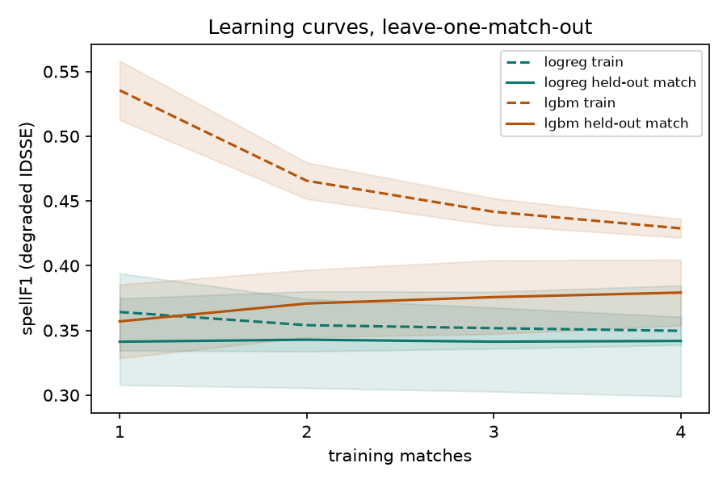
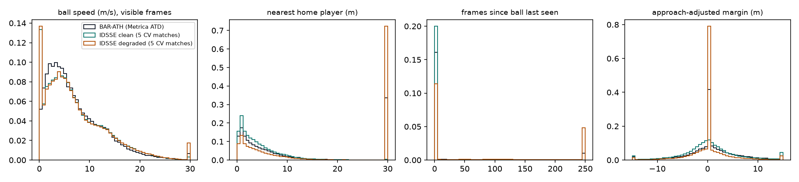

# Overfitting and Domain-Shift Report

**Team Let'sC · More than a Hack 2027, Phase 1 · research round on external labelled data**

## Verdict

- **Overfitting: none detected in model selection.** Every choice was made by leave-one-match-out
  cross-validation (CV) on five IDSSE matches. On the two untouched test matches, evaluated once,
  the selected model scored 0.373 against a CV estimate of 0.382. LightGBM has a moderate
  train-validation gap (+0.044), which shrinks as training matches are added; logistic regression
  has almost none (+0.008).
- **Domain shift: moderate, and transfer to the competition match is uncertain.** An unlabelled
  classifier separates degraded IDSSE from Metrica's BAR-ATH tracking with AUC 0.755. On BAR-ATH
  the label-free proxies are mixed: more tagged turnovers are found, earlier, but agreement with
  held-out team tags is lower and there is more flicker.
- **Decision: keep the current speed-gate submission.** The learned model is the strongest
  externally validated candidate, but not convincingly validated *for Metrica data*. No final
  file was changed.

---

## 1. Data and separation

- **External labels: IDSSE**, seven 2022/23 Bundesliga matches. TRACAB tracking at 25 Hz with
  per-frame `BallStatus` and `BallPossession` from the official provider. CC BY 4.0, DFL;
  doi:10.6084/m9.figshare.28196177. Source, licence and download script:
  `experiments/EXTERNAL_DATA.md`.
- **Ground truth** is built as the competition describes its own: D where the ball is dead,
  otherwise the possessing team.
- **Split, by whole match only:**
  - CV with leave-one-match-out: J03WMX, J03WN1, J03WOH, J03WOY, J03WPY.
  - Test: J03WQQ and J03WR9. These were touched once, after `data/cache/overfit/frozen.json`
    was written; `final_run.log` blocks a second run.
- **Never used:** frames or windows split across folds; the competition's public 5-minute ground
  truth; any human data about BAR-ATH.
- **Degradation to Metrica conditions.** IDSSE tracking is clean (ball on 100% of frames, all
  22 players), so each match was degraded to BAR-ATH's *measured*, label-free tracking
  statistics:
  - ball visible/missing run lengths resampled from BAR-ATH's own runs;
  - false ball detections at BAR-ATH's rate of implausible jumps (0.47% of seen frames);
  - player dropout to about 20.5 tracked of 22;
  - ball jitter calibrated to BAR-ATH's fast-ball noise floor (the calibration chose 0 m).

## 2. Candidates

| Candidate | What it is | Fitted on labels? |
| :--- | :--- | :--- |
| `rule_frozen` | The submitted pipeline, unchanged | No |
| `rule_tuned` | Same rules, settings chosen per fold from a 54-point grid (confirmation, boundary placement, speed gate, margin) | Grid search |
| `logreg` | Logistic regression on 20 tracking-derived features + Viterbi decoder (cost K per hand-over) | Yes |
| `lgbm` | LightGBM (200 trees, 31 leaves) on the same features + the same decoder | Yes |

All four share the frozen dead-ball rule and differ only in who has the ball.

**Hyperparameters.** K is chosen by *nested* leave-one-match-out inside the four training
matches of each fold. The rule grid is chosen on the same four matches.

**Choices are stable across folds.**
- `rule_tuned` picks identical settings in all 5 folds: 12-frame confirmation, boundary
  moved back at most 12 frames, 10 m/s gate, 0.5 m margin.
- K = 10 for LightGBM in 4 of 5 folds.

## 3. Results

### Train, cross-validation and test (spellF1, official scorer)

| Candidate | Train | CV (5 held-out matches) | Gap | Test J03WQQ | Test J03WR9 | Test mean |
| :--- | :---: | :---: | :---: | :---: | :---: | :---: |
| `rule_frozen` (submitted) | 0.293 | 0.293 ± 0.031 | 0.000 | 0.326 | 0.288 | 0.307 |
| `rule_tuned` | 0.333 | 0.333 ± 0.039 | 0.000 | 0.336 | 0.292 | 0.314 |
| `logreg` | 0.349 | 0.341 ± 0.043 | +0.008 | 0.335 | 0.348 | 0.342 |
| `lgbm` | 0.426 | **0.382 ± 0.027** | +0.044 | **0.369** | **0.378** | **0.373** |

± is the standard deviation across the 5 held-out matches. "Train" for the rules is their
score on the training matches; `rule_frozen` is not fitted at all.

### Per-match gain over the submitted rule (CV)

| Candidate | J03WMX | J03WN1 | J03WOH | J03WOY | J03WPY | Mean, 95% t-interval |
| :--- | :---: | :---: | :---: | :---: | :---: | :---: |
| `rule_tuned` | +0.052 | +0.044 | +0.051 | +0.035 | +0.019 | +0.040 [+0.023, +0.057] |
| `logreg` | +0.037 | +0.044 | +0.074 | +0.052 | +0.034 | +0.048 [+0.028, +0.068] |
| `lgbm` | +0.097 | +0.094 | +0.077 | +0.084 | +0.094 | +0.089 [+0.078, +0.100] |

- **Across 3 seeds** (degradation and model), LightGBM beat the submitted rule in **15 of 15**
  match-seed pairs (+0.030 to +0.106) and the tuned rule in 15 of 15.
- **The seed-to-seed standard deviation** of the CV mean is about 0.008 for every candidate.
- **Five matches is a small sample.** The t-intervals assume match-level exchangeability; the
  two test matches only confirm direction.

### Transitions, timing and fragmentation (test-match means)

| Candidate | macroF1 | Hand-over recall | Hand-over precision | Median hand-over timing | Possessions under 2 s |
| :--- | :---: | :---: | :---: | :---: | :---: |
| `rule_frozen` | 0.732 | 0.255 | 0.585 | **+13.5 frames late** | 15.5% |
| `rule_tuned` | 0.734 | 0.294 | 0.553 | -2.8 | 18.5% |
| `logreg` | 0.744 | 0.300 | 0.635 | -1.5 | 14.7% |
| `lgbm` | 0.747 | 0.369 | 0.601 | -1.8 | 18.3% |

**Experiment B is confirmed on real labels.**
- **The submitted rule reports hand-overs about 13–15 frames after they happen,** both in CV
  (+14.8) and on test (+13.5). That is the confirmation delay found on BAR-ATH.
- **Moving the boundary back** (`rule_tuned`) or decoding learned evidence removes the delay.
- **Every candidate misses most true hand-overs on degraded tracking** (recall 0.26–0.37). The
  frozen rule predicts roughly 250–275 possessions where the truth has 370–500.

### Confidence reliability (experiment A)

- **Calibration of per-frame P(home)** on held-out live frames is good: expected calibration
  error 0.028 (LightGBM) and 0.029 (logistic regression); Brier score 0.139 and 0.147.
- **Abstaining with `X` is not a lever for spellF1.** A property test against the official
  scorer (`tests/test_scorer_x.py`, 40 random files) shows `X` is exactly "hold the previous
  label" for every temporal metric, so it can only move macroF1, the tie-breaker.

## 4. Learning curves

| Training matches | LightGBM train | LightGBM held-out | Logistic train | Logistic held-out |
| :---: | :---: | :---: | :---: | :---: |
| 1 | 0.536 | 0.357 | 0.364 | 0.341 |
| 2 | 0.466 | 0.371 | 0.354 | 0.343 |
| 3 | 0.442 | 0.376 | 0.352 | 0.341 |
| 4 | 0.429 | 0.379 | 0.350 | 0.342 |

- **LightGBM** overfits strongly on one match (gap 0.18); the gap narrows to 0.05 at four
  matches, and held-out spellF1 is still rising. More labelled matches would likely help.
- **Logistic regression** is saturated: low variance, little gain from more data.

## 5. Ablations, shortcuts and leakage

Cross-validation spellF1 with one feature group removed, K fixed at the fold's selected value:

| Variant | Logistic | LightGBM |
| :--- | :---: | :---: |
| All default groups | 0.341 | 0.382 |
| − proximity | 0.340 | 0.374 |
| − ball | 0.345 | 0.382 |
| − past control context | **0.297** | **0.315** |
| − future control context | 0.360 | 0.385 |
| − frozen-rule state | 0.357 | 0.379 |
| + pitch position (shortcut check) | 0.341 | 0.381 |
| Proximity only | 0.219 | 0.289 |
| **Labels shuffled in 10 s blocks** | **0.100** | **0.133** |

- **No leakage.**
  - The feature builder (`experiments/learn.py:features`) accepts only tracking-derived
    signals, so ground truth cannot reach a feature.
  - With shuffled labels, held-out spellF1 collapses far below even the frozen rule (0.10–0.13
    vs 0.29).
  - No IDSSE possession or ball-status field is a model input. Ball height is not used either:
    Metrica has none.
- **No position shortcut.** Adding absolute pitch position changes nothing, so the models do
  not exploit attacking direction.
- **Stable dependency: recent control history.** Removing it costs about 0.05–0.07; it is the
  same evidence the rule uses, accumulated over time.
- **Possible over-specification.** Removing the future-context or rule-state groups slightly
  *raises* logistic regression (+0.016 to +0.019). This was found after the configuration was
  frozen, so it was not acted on: re-selecting now would tune against the same five matches.

## 6. Domain shift: IDSSE vs Metrica BAR-ATH

| Dataset (live frames) | Ball visible | Ball speed p50 / p90 | Nearest player p50 / p90 | Rule hand-overs per min |
| :--- | :---: | :---: | :---: | :---: |
| BAR-ATH (Metrica ATD) | 80% | 5.8 / 14.7 m/s | 1.9 / 6.5 m | 4.57 |
| IDSSE clean | 100% | 5.9 / 15.4 m/s | 1.5 / 5.8 m | 4.60 |
| IDSSE degraded | 57% | 5.9 / 15.8 m/s | 1.5 / 6.0 m | 2.89 |

All three run at 25 Hz.

- **Ball kinematics match closely.** Nearest-player distances are about 0.4 m larger on
  BAR-ATH: noisier player positions.
- **Biggest mismatch: ball visibility in live play.** On BAR-ATH the missing ball clusters in
  stoppages, so live play keeps 80% visibility. The degradation drops it uniformly, so live
  play keeps 57%. Degraded IDSSE is therefore *harsher* than the real match.
- **Domain classifier.** LightGBM separating BAR-ATH from degraded IDSSE, with 100 s blocks as
  the CV unit: **AUC 0.755 ± 0.035**. The most separating single features are all ball
  visibility and evidence age (univariate AUC 0.61–0.63).

## 7. Sensitivity (CV mean spellF1)

| Setting | Frozen rule | Tuned rule | Logistic | LightGBM |
| :--- | :---: | :---: | :---: | :---: |
| Calibrated degradation | 0.293 | 0.333 | 0.341 | 0.382 |
| Ball jitter 0.2 m | 0.278 | 0.319 | 0.330 | 0.361 |
| Ball jitter 0.4 m | 0.256 | 0.306 | 0.317 | 0.344 |
| +30% more missing-ball runs | 0.231 | n/a | 0.274 | 0.300 |
| Identity swaps ×4 | 0.285 | n/a | 0.334 | 0.370 |
| Player dropout ×3 | 0.279 | n/a | 0.321 | 0.357 |
| 12.5 Hz (sample-and-hold) | 0.286 | n/a | 0.341 | 0.382 |
| Live visibility 80% (BAR-ATH-like) | 0.350 | 0.389 | 0.391 | 0.448 |

- **The ordering never changes,** and LightGBM's lead over the frozen rule stays at +0.07 to
  +0.10 in every setting.
- **Missing ball is the dominant risk** for every method.
- The first run's "jitter ×2" setting was 2 × 0 m and tested nothing; it was replaced by the
  0.2 m and 0.4 m rows.

## 8. Transfer to the competition match (label-free proxy, not accuracy)

Models were trained on the five CV matches and applied to BAR-ATH, then compared with
`evaluation/self_check.py` (automatic Smart Tags, held out):

| Candidate | Team agreement | Tagged turnovers found | Median lateness | Possessions | Ping-pongs |
| :--- | :---: | :---: | :---: | :---: | :---: |
| `rule_frozen` (submitted) | **0.776** | 75% | 53 frames | 391 | **37** |
| `rule_tuned` | 0.749* | 79% | 29 | 491 | 92 |
| `logreg` | 0.769 | 88% | 45 | 423 | 51 |
| `lgbm` | 0.746* | **92%**† | 31 | 510 | 82 |

\* paired-bootstrap interval below zero; † above zero.

- **LightGBM reproduces its Bundesliga behaviour on Metrica data:** more turnovers, found
  earlier. With 370–500 true possessions per Bundesliga match, the extra hand-overs may be real.
- **But it agrees less with the held-out team tags and flickers more.** Those signals have
  served as the decision basis throughout this project.
- **The proxies cannot settle which is right.** Combined with the domain classifier, this is
  not convincing evidence of better full-match accuracy on BAR-ATH.

## 9. Caveats

- **The possession definition may differ.** IDSSE labels follow DFL's definition ("player in
  control"); the competition's comes from Metrica's corrected tracking.
- **The degradation is a model.** Its biggest known mismatch, live-play ball visibility, makes
  IDSSE harsher, not easier.
- **Small sample:** five CV matches and two test matches. Intervals are match-level; nothing
  here is significant at the scale of a full league.
- **Runtime and reproducibility.**
  - A full LOMO run takes about 7 minutes on a laptop CPU; the decode adds under 1 s per match.
  - All runs are seeded, with LightGBM in deterministic mode.
  - Results live in `data/cache/overfit/*.csv` and are regenerated by
    `experiments/overfit_study.py`.

## 10. Recommendation

1. **Keep the submitted speed-gate file.** Nothing was promoted, and no final file was changed.
2. **LightGBM is the best externally validated model:** +0.089 CV, +0.066 test mean, consistent
   on every match and seed. Its weak point is transfer, not overfitting.
   - To promote it would need either labelled data closer to Metrica's automatic tracking, or a
     team decision to accept the mixed BAR-ATH proxies.
   - It would also need technical-document changes describing the training data, as the rules
     require.
3. **The cheapest proven fix is the hand-over delay.** It is about 14 frames on real labels and
   is removed by the tuned rule's 12-frame boundary move. But the tuned rule as a whole also
   lowers BAR-ATH team agreement, so it is not promoted either.
